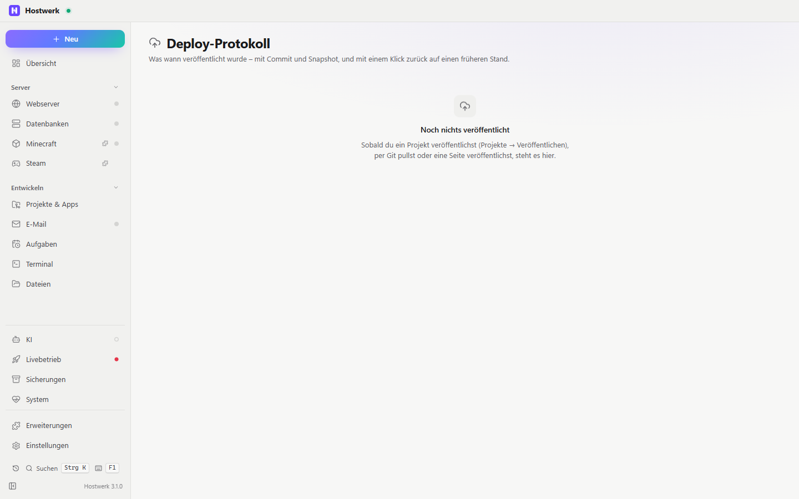

# Deploy-Protokoll

Jedes Veröffentlichen, jeder Git-Pull und jede veröffentlichte Seite mit Zeit, Stand (Commit und Snapshot) und Ergebnis – je Projekt, mit einem Klick zurück auf einen früheren Stand.

[English](README.md) · Offizielle [Hostwerk](https://github.com/Passimoritz/hostwerk-public)-Erweiterung (native Erweiterung, ab Hostwerk 2.11)



## Was sie kann

- **Wo:** Projekte → Deploy-Protokoll (alle Projekte) und Reiter jedes Projekts – seit 1.1.0 ohne eigenen Seitenleisten-Eintrag; die ganze Seite bleibt unter Erweiterungen → Öffnen
- Protokolliert von selbst, ohne Einrichtung: **Veröffentlichen** auf einen Server (SFTP, FTP, Git-Push), **Git-Pull** in Hostwerk und **Seiten veröffentlichen** (GitHub Pages, Cloudflare Pages, Erweiterung [static-publish](https://github.com/Passimoritz/hostwerk-ext-static-publish)); auch das Zurückholen eines Snapshots erscheint
- Jeder Eintrag: Zeit und Dauer, Ziel, Ergebnis (hochgeladene/entfernte Dateien, Adresse oder der Fehler), der **Commit** (Zweig, kurzer Hash, Nachricht und wie viele Dateien davon abwichen) und der **Snapshot** dieses Stands
- **Zurück auf den vorherigen Stand** mit einem Klick – oder auf jeden beliebigen Eintrag: Hostwerk sichert zuerst den aktuellen Stand als Snapshot und holt dann die Projektdateien von damals zurück; auf Wunsch wird der alte Stand gleich wieder auf denselben Server oder dieselbe Seite veröffentlicht
- Eigene Seite mit allen Projekten, ein **Reiter „Deploy-Protokoll“ an jedem Projekt** und eine Kachel für die Übersicht mit den neuesten Einträgen; Rechtsklick auf einen Eintrag geht zurück, kopiert den Commit-Hash oder öffnet die Adresse
- Einstellungen: nach jedem erfolgreichen Veröffentlichen oder Pull einen Snapshot anlegen (Standard an; sonst wird der neueste vorhandene Snapshot vermerkt), wie viele eigene Snapshots je Projekt bleiben (Standard 10 – selbst angelegte Snapshots werden nie angefasst)

## So funktioniert es

Die Erweiterung nutzt nur, was Hostwerk schon anbietet: Sie hört auf Hostwerks eigene Ereignisse (Aufgaben fürs Veröffentlichen und Seiten veröffentlichen, das Änderungsprotokoll für Git-Pull, Snapshot-Zurückholen), liest den Commit über Hostwerks Git-Dienst und nimmt fürs Zurückgehen Hostwerks Snapshots und das Veröffentlichen selbst. Datenbanken werden nie zurückgesetzt – nur Projektdateien.

Grenzen: Ein **fehlgeschlagener** Git-Pull erscheint nicht (Hostwerk meldet nur erfolgreiche), und ein Ziel vom Typ „Git-Push“ wird beim Zurückgehen nicht erneut gepusht – zurückgeholte Dateien ändern keine Commits.

## Installieren

In Hostwerk: **Erweiterungen → Entdecken** und „Installieren“ klicken.

Native Erweiterungen laufen als Teil von Hostwerk (eigener Server- und Oberflächen-Teil). Deshalb installiert Hostwerk sie nur aus dem offiziellen Katalog (mit Prüfsumme) oder im Entwickler-Modus.

## Daten

`data/deploy-log/log.json` – bis zu 200 Einträge je Projekt (keine Passwörter oder Ziel-Einstellungen, nur Name und Art des Ziels). Snapshots liegen dort, wo Hostwerk alle Snapshots ablegt (`backups/snapshots/<projekt>`). Beim Entfernen der Erweiterung bleibt beides erhalten.

## Entwickeln

```bash
node --test tests/*.test.js          # Tests mit nachgebildetem Hostwerk (Ereignisse, Snapshots, Veröffentlichen)
node build-native.js .               # Oberfläche bauen (sdk/build-native.js aus hostwerk-public)
node check.js . --strict             # dieselbe Prüfung wie der Katalog (sdk/check.js)
```

Erkennen der Ereignisse und Buchführung in `server/log.js` (ohne Hostwerk testbar), Verdrahtung in `server/index.js`, Oberfläche in `ui/src`. Texte im Code sind Englisch, Deutsch steht in `locales/de.json`.

## Lizenz

MIT
